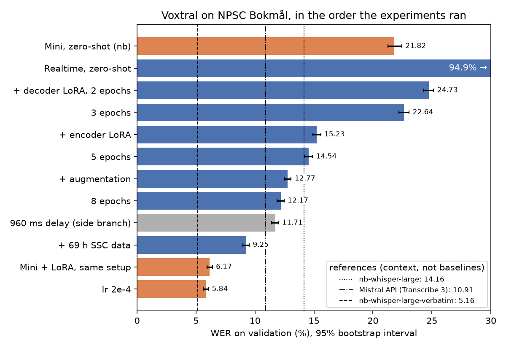

# voxtral-norwegian

LoRA fine-tuning of Mistral's open Voxtral speech-to-text models for Norwegian
(Bokmål), evaluated on the Norwegian Parliamentary Speech Corpus. The project
reports word error rate before and after fine-tuning, with an error analysis
by dialect region, numbers and proper names.

**Status:** experiments and the final test are done. The full write-up,
with method, error analysis and limitations, is
[`reports/writeup.md`](reports/writeup.md). Every choice was made on the
validation split; the test split was scored once, at the end, for systems
fixed beforehand.
Norwegian is not an officially supported language of the open Voxtral
models, so the zero-shot numbers are for an unsupported language.

| system (test, 5,006 utterances, all speakers unseen in training) | WER |
|---|---|
| Voxtral Realtime 4B, zero-shot (480 ms) | 94.97% |
| Voxtral Mini 3B, zero-shot (language hint `nb`) | 21.28% |
| Voxtral Realtime 4B + LoRA, NPSC + SSC (480 ms, streaming) | 9.81% |
| **Voxtral Mini 3B + LoRA, NPSC + SSC (offline), final model** | **5.91%** |
| *Reference:* Mistral API, Voxtral Mini Transcribe 3 | 10.67% |
| *Reference:* NbAiLab nb-whisper-large-verbatim | 5.02% |

95% bootstrap intervals are ±0.3 points or less for the fine-tuned models
(`reports/final_test.md`). With numbers and spoken forms taken out, the
final model is 2.9 points ahead of the API model and 2.0 points behind
nb-whisper-large-verbatim, which writes numbers as digits.



The figure shows the path there, on validation. The references are
context, not baselines: nb-whisper was trained on Norwegian parliament
speech, and the API model is not open.

Prior work is cited in [`docs/references.md`](docs/references.md).
Dataset statistics are in [`reports/data.md`](reports/data.md). How to run
on a cloud GPU: [`docs/cloud.md`](docs/cloud.md).

## Pipeline

Each step is one script; the `run_*.py` drivers chain them, resume after a
disconnect and zip the small outputs (the Colab notebooks only call them).

| step | script |
|---|---|
| zero-shot baselines | `scripts/run_baseline.py` |
| word alignment of the training set (CTC) | `scripts/align_train.py` |
| extra training data from the Stortinget Speech Corpus | `scripts/build_ssc.py` |
| LoRA fine-tuning, checkpoint choice, full validation | `scripts/run_finetune.py` (`scripts/finetune.py`) |
| reference systems | `scripts/run_reference.py`, `scripts/run_api_reference.py` |
| comparisons and error analysis | `scripts/report.py`, `scripts/compare_validation.py`, `scripts/analyse_finetune.py` |
| progress figure | `scripts/plot_progress.py` |
| final test, once | `scripts/run_test_eval.py` |

Code lives in `src/voxnor/` (normaliser, metrics, data, transcribers,
training); `scripts/` are thin command-line wrappers around it.

## Evaluation

```sh
python scripts/evaluate.py --config configs/local.yaml --splits validation
python scripts/report.py --split validation --out reports/x.md runs/<run> [runs/<run> ...]
```

Scoring is described in the write-up (section 1). References are the dataset's
`standardized_text`, numbers are never auto-converted, and every WER comes
with a 95% bootstrap interval. The test split needs `--allow-test`.

## Setup

Requires Python 3.11–3.13. With [uv](https://docs.astral.sh/uv/):

```sh
uv venv --python 3.11 .venv
uv pip install --python .venv -e ".[dev]"
```

Or with plain pip: `python -m venv .venv`, activate it, then
`pip install -e ".[dev]"`. All dependencies are pinned to exact versions in
`pyproject.toml`.

## Running locally vs. on a GPU

Each run is described by a YAML profile in `configs/`:

| Profile | Model | Data | Device |
|---|---|---|---|
| `local.yaml` | tiny random model with the real architecture (no download) | 20 utterances | CPU |
| `cloud.yaml` | `mistralai/Voxtral-Mini-4B-Realtime-2602`, bf16 (Mini via `--set`) | full splits | CUDA |

Any value can be overridden on the command line:

```sh
python scripts/smoke.py --config configs/local.yaml
python scripts/smoke.py --config configs/cloud.yaml \
    --set model.family=voxtral model.hf_id=mistralai/Voxtral-Mini-3B-2507
```

Every run writes `runs/<timestamp>_<name>/` with the resolved config and an
`environment.json` (package versions, GPU, git commit, and whether the
working tree had uncommitted changes).

## Tests

```sh
python -m pytest
```

The tests run on CPU, need no network access and use the tiny models.

## Licence

The code is released under the Apache License 2.0 ([`LICENSE`](LICENSE)).
The data and models it uses keep their own licences (NPSC and SSC: CC0;
Voxtral, NB-Whisper and the NbAiLab aligner: Apache-2.0), listed in
[`docs/references.md`](docs/references.md).
