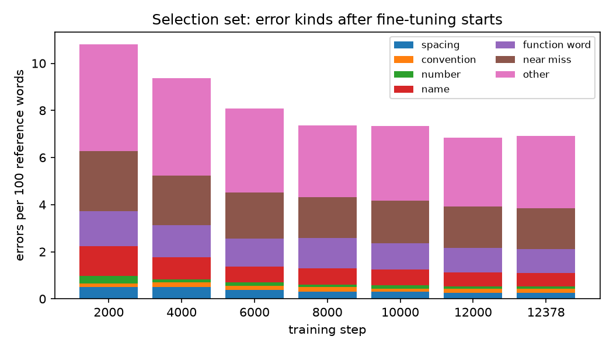
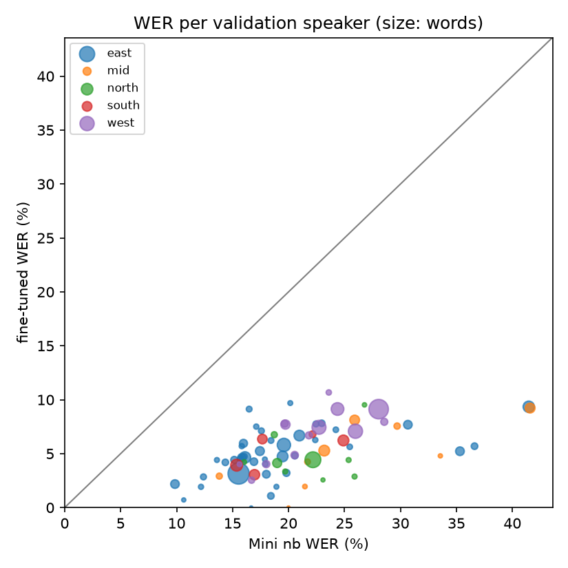

# Fine-tuned model vs Mini `nb`: error analysis (validation)

Fine-tuned model: Voxtral-Mini-3B-2507 + LoRA finetune-mini-enc-aug-ssc-lr2e-4 step-012000 (language: nb).

Made by `scripts/analyse_finetune.py`; method and caveats in `reports/writeup.md`. Error rates are corpus-level, intervals are 95% bootstrap intervals over utterances.

## 1. With the spelling convention removed

Numbers: only utterances without number words in the reference. Spoken forms: `voxnor.variants` folds spoken and standard Bokmål forms together on both sides (feminine and past-tense `-a`, `sjøl`/`selv`, `meiner`/`mener`, and the spoken|normalised pairs marked in the NPSC transcripts). Danish spellings are not folded.

| scoring | utts | Mini `nb` | fine-tuned | fine-tuned minus Mini `nb` | resamples where fine-tuned is not better |
| --- | --- | --- | --- | --- | --- |
| all utterances, official scoring | 5409 | 21.82 [21.27, 22.46] | 5.84 [5.61, 6.05] | -15.98 [-16.61, -15.48] | 0.000 |
| number-free utterances | 4775 | 20.44 [20.02, 20.89] | 5.83 [5.61, 6.10] | -14.60 [-15.01, -14.18] | 0.000 |
| number-free, spoken/standard forms folded | 4775 | 19.55 [19.13, 20.01] | 5.69 [5.47, 5.95] | -13.86 [-14.27, -13.46] | 0.000 |

Folding changes 8.4% of the reference words in the number-free utterances.

## 2. What training fixes first (selection set)

The 591 scored selection utterances at every evaluated step. Error kinds in errors per 100 reference words; they add up to the WER. *Unknown words*: share of output words that never occur in a train or validation transcript (made-up words, other languages).

| step | WER | spacing | convention | number | name | function word | near miss | other | empty outputs | unknown words |
| --- | --- | --- | --- | --- | --- | --- | --- | --- | --- | --- |
| 0 | 22.0 | 0.4 | 0.6 | 1.8 | 2.5 | 2.8 | 4.6 | 9.3 | 0.0% | 7.1% |
| 2000 | 10.8 | 0.5 | 0.2 | 0.3 | 1.3 | 1.5 | 2.5 | 4.5 | 0.0% | 2.5% |
| 4000 | 9.4 | 0.5 | 0.2 | 0.1 | 0.9 | 1.4 | 2.1 | 4.1 | 0.0% | 2.1% |
| 6000 | 8.1 | 0.4 | 0.2 | 0.2 | 0.6 | 1.2 | 2.0 | 3.6 | 0.0% | 1.8% |
| 8000 | 7.4 | 0.3 | 0.2 | 0.1 | 0.7 | 1.3 | 1.7 | 3.1 | 0.0% | 1.6% |
| 10000 | 7.3 | 0.3 | 0.1 | 0.1 | 0.7 | 1.1 | 1.8 | 3.2 | 0.0% | 1.6% |
| 12000 | 6.9 | 0.3 | 0.2 | 0.1 | 0.6 | 1.0 | 1.8 | 2.9 | 0.0% | 1.5% |
| 12378 | 6.9 | 0.3 | 0.2 | 0.1 | 0.6 | 1.0 | 1.7 | 3.1 | 0.0% | 1.5% |

## 3. Error kinds on full validation

Errors per 100 reference words, by the first kind that applies (`voxnor.error_analysis`).

| kind | Mini `nb` | fine-tuned | difference |
| --- | --- | --- | --- |
| spacing | 0.39 | 0.29 | -0.10 |
| convention | 0.60 | 0.12 | -0.48 |
| number | 1.91 | 0.08 | -1.83 |
| name | 2.17 | 0.52 | -1.65 |
| function word | 2.49 | 0.96 | -1.53 |
| near miss | 4.80 | 1.44 | -3.36 |
| other | 9.45 | 2.42 | -7.04 |
| **all (WER)** | 21.82 | 5.84 | -15.98 |

Most frequent error regions, Mini `nb`:

| kind | reference → output (count) |
| --- | --- |
| spacing | *eus* → *eu s* (5), *fns* → *fn s* (4), *italienskeid* → *italiensk eid* (4), *utover* → *ut over* (4), *hvert fall* → *hvertfall* (3), *selvsagt* → *selv sagt* (3) |
| convention | *regjeringa* → *regjeringen* (50), *fram* → *frem* (48), *meiner* → *mener* (29), *ei* → *en* (29), *sjøl* → *selv* (28), *syns* → *synes* (18) |
| number | *tre hundre og femti* → *350* (21), *fem* → *5* (20), *tjuesytten* → *2017* (19), *tjuenitten* → *2019* (13), *tjueatten* → *2018* (12), *ti* → *10* (12) |
| name | *eøs* → *eu* (30), *eøs* → *eus* (16), *finnmark* → *finland* (12), *riksrevisjonen* → *riksrevisionen* (9), *kaski* → *kaske* (9), *skagerrak* → *skagerak* (9) |
| function word | *og* → *∅* (323), *så* → *∅* (173), *jo* → *∅* (111), *det* → *∅* (84), *og* → *også* (67), *i* → *∅* (55) |
| near miss | *president* → *præsident* (97), *regjeringen* → *regeringen* (37), *takk* → *tak* (27), *vårt* → *vår* (22), *president* → *prasident* (18), *heile* → *hele* (17) |
| other | *altså* → *∅* (42), *nettopp* → *netop* (33), *sånn* → *sådan* (33), *dem* → *de* (31), *regjeringa* → *regeringen* (24), *det her* → *dette* (23) |

Most frequent error regions, fine-tuned:

| kind | reference → output (count) |
| --- | --- |
| spacing | *ifra* → *i fra* (7), *i fra* → *ifra* (5), *italienskeid* → *italiensk eid* (4), *innover* → *inn over* (4), *en gang* → *engang* (3), *steinar ness* → *steinarness* (3) |
| convention | *synes* → *syns* (8), *mener* → *meiner* (7), *seier* → *sier* (7), *frem* → *fram* (5), *syns* → *synes* (5), *anna* → *annet* (5) |
| number | *førtiåtte* → *førtioåtte* (2), *hundre* → *hundrede* (1), *åttende mars markeringa* → *våtna marsmarkeringa* (1), *åttende mars* → *åttomars* (1), *tjuesytten* → *sju sytten* (1), *tjuetredje* → *sju tredevde* (1) |
| name | *skagerrak* → *skagerakk* (4), *røsland* → *røe isaksen* (3), *krfs* → *krf* (3), *smb* → *snb* (3), *skagerrak* → *skagerak* (3), *arnstad* → *amundsen* (2) |
| function word | *er* → *∅* (37), *i* → *∅* (36), *det* → *∅* (36), *∅* → *er* (35), *∅* → *i* (32), *jo* → *∅* (28) |
| near miss | *igjennom* → *gjennom* (7), *mere* → *mer* (6), *taksering* → *takstering* (6), *heile* → *hele* (5), *gjennom* → *igjennom* (5), *forskjellig* → *forskjellige* (5) |
| other | *ett* → *et* (11), *e* → *∅* (11), *f* → *∅* (9), *s* → *∅* (9), *også* → *altså* (9), *ei* → *∅* (9) |

## 4. WER per speaker

78 speakers; the fine-tuned model is better for 78. *Seen*: the speaker also occurs in the training data (validation speakers were not removed from training).

| region | speaker | seen | reference words | Mini `nb` | fine-tuned |
| --- | --- | --- | --- | --- | --- |
| east | npsc_25 | yes | 8462 | 15.5 | 3.2 |
| east | npsc_77 | yes | 3237 | 19.6 | 5.8 |
| east | npsc_289 | no | 2322 | 16.1 | 4.7 |
| east | npsc_32 | no | 2289 | 41.5 | 9.3 |
| east | npsc_29 | yes | 2044 | 19.5 | 4.7 |
| east | npsc_13 | no | 2022 | 21.0 | 6.7 |
| east | npsc_11 | no | 1336 | 17.4 | 5.2 |
| east | npsc_176 | yes | 1263 | 35.3 | 5.2 |
| east | npsc_86 | no | 1238 | 9.9 | 2.2 |
| east | npsc_90 | no | 1223 | 30.7 | 7.7 |
| east | npsc_37 | yes | 1081 | 15.8 | 4.6 |
| east | npsc_184 | no | 1058 | 16.0 | 6.0 |
| east | npsc_27 | yes | 938 | 18.0 | 3.1 |
| east | npsc_157 | no | 893 | 16.9 | 4.3 |
| east | npsc_71 | no | 747 | 19.8 | 3.2 |
| east | npsc_163 | no | 746 | 15.1 | 4.4 |
| east | npsc_88 | yes | 650 | 36.6 | 5.7 |
| east | npsc_185 | no | 646 | 18.4 | 1.1 |
| east | npsc_120 | no | 620 | 14.4 | 4.2 |
| east | npsc_61 | no | 614 | 23.0 | 7.8 |
| east | npsc_147 | no | 603 | 20.6 | 4.8 |
| east | npsc_187 | yes | 554 | 15.7 | 4.5 |
| east | npsc_136 | yes | 549 | 16.0 | 4.7 |
| east | npsc_137 | no | 492 | 12.4 | 2.8 |
| east | npsc_4 | yes | 490 | 22.4 | 7.8 |
| east | npsc_79 | no | 478 | 17.6 | 7.1 |
| east | npsc_189 | no | 449 | 16.5 | 9.1 |
| east | npsc_171 | no | 434 | 18.4 | 6.2 |
| east | npsc_284 | no | 396 | 17.9 | 4.0 |
| east | npsc_174 | yes | 388 | 24.2 | 7.2 |
| east | npsc_74 | no | 373 | 25.5 | 5.6 |
| east | npsc_38 | yes | 335 | 22.4 | 6.3 |
| east | npsc_251 | yes | 333 | 17.1 | 7.5 |
| east | npsc_129 | no | 316 | 15.8 | 5.7 |
| east | npsc_286 | yes | 312 | 12.2 | 1.9 |
| east | npsc_54 | no | 272 | 13.6 | 4.4 |
| east | npsc_273 | yes | 259 | 18.9 | 1.9 |
| east | npsc_73 | no | 258 | 20.2 | 9.7 |
| east | npsc_173 | no | 246 | 17.9 | 4.5 |
| east | npsc_143 | no | 141 | 10.6 | 0.7 |
| east | npsc_186 | no | 12 | 16.7 | 0.0 |
| mid | npsc_17 | no | 2044 | 23.2 | 5.3 |
| mid | npsc_122 | yes | 1669 | 41.6 | 9.2 |
| mid | npsc_125 | no | 1625 | 25.9 | 8.1 |
| mid | npsc_16 | no | 569 | 29.7 | 7.6 |
| mid | npsc_91 | yes | 514 | 13.8 | 2.9 |
| mid | npsc_12 | yes | 424 | 21.7 | 4.2 |
| mid | npsc_139 | no | 205 | 21.5 | 2.0 |
| mid | npsc_43 | yes | 146 | 33.6 | 4.8 |
| mid | npsc_221 | no | 10 | 20.0 | 0.0 |
| north | npsc_226 | yes | 4621 | 22.2 | 4.4 |
| north | npsc_285 | yes | 1380 | 19.0 | 4.1 |
| north | npsc_160 | no | 518 | 18.7 | 6.8 |
| north | npsc_126 | yes | 278 | 25.9 | 2.9 |
| north | npsc_35 | no | 272 | 25.4 | 4.4 |
| north | npsc_268 | yes | 269 | 19.7 | 3.3 |
| north | npsc_151 | no | 237 | 16.0 | 4.2 |
| north | npsc_195 | yes | 168 | 26.8 | 9.5 |
| north | npsc_127 | yes | 117 | 23.1 | 2.6 |
| south | npsc_114 | yes | 2519 | 15.4 | 3.9 |
| south | npsc_51 | yes | 2072 | 24.9 | 6.2 |
| south | npsc_39 | no | 1869 | 17.0 | 3.0 |
| south | npsc_107 | no | 1574 | 17.7 | 6.4 |
| south | npsc_30 | no | 691 | 22.1 | 6.8 |
| unknown | npsc_21 | yes | 8 | 112.5 | 87.5 |
| west | npsc_132 | no | 7144 | 28.1 | 9.1 |
| west | npsc_283 | yes | 3715 | 26.0 | 7.1 |
| west | npsc_26 | no | 3534 | 22.7 | 7.4 |
| west | npsc_40 | no | 2921 | 24.4 | 9.1 |
| west | npsc_159 | no | 1455 | 19.7 | 7.7 |
| west | npsc_145 | no | 842 | 20.5 | 4.9 |
| west | npsc_162 | no | 794 | 18.0 | 4.0 |
| west | npsc_288 | no | 767 | 28.6 | 8.0 |
| west | npsc_158 | no | 758 | 19.7 | 7.8 |
| west | npsc_124 | yes | 747 | 21.8 | 6.7 |
| west | npsc_164 | no | 551 | 16.7 | 2.5 |
| west | npsc_89 | no | 356 | 23.6 | 10.7 |
| west | npsc_188 | yes | 224 | 15.6 | 4.0 |

