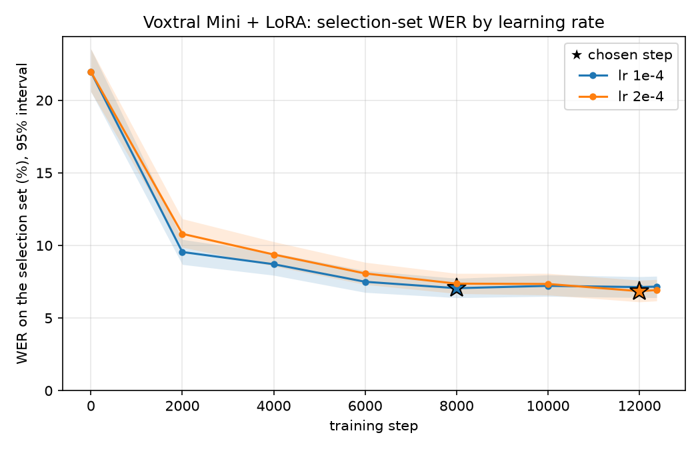

# Fine-tuning Voxtral for Norwegian: write-up

Norwegian is not a listed language of Mistral's open Voxtral speech models.
Zero-shot, Voxtral Realtime 4B switches between languages and scores 94.97%
WER on the NPSC Bokmål test set, and Voxtral Mini 3B with the hint `nb`
scores 21.28%. LoRA fine-tuning on 32.6 h of NPSC, plus 69 h of filtered
speech from the Stortinget Speech Corpus, brings Voxtral Mini to **5.91%**
and the streaming Realtime model to **9.81%** on test. For context:
nb-whisper-large-verbatim, trained on about 66,000 h of Norwegian including
parliament speech, scores 5.02%, and Mistral's own API model (Voxtral Mini
Transcribe 3) 10.67%.

Every choice was made on validation. The test split was scored once, at
the end, for systems fixed in advance. Numbers in brackets are 95%
bootstrap intervals.

Contents: [1. Setup](#1-problem-and-setup) ·
[2. Zero-shot](#2-zero-shot-baselines) · [3. Method](#3-method) ·
[4. Experiments](#4-the-experiment-path-validation-only) ·
[5. Test](#5-results-on-test) · [6. Errors](#6-error-analysis-final-model) ·
[7. References](#7-the-reference-systems) · [8. Limitations](#8-limitations) ·
[9. Reproducing](#9-reproducing)

## 1. Problem and setup

**Models**. Mistral's open speech-to-text checkpoints are
`Voxtral-Mini-4B-Realtime-2602` (streaming, Apache-2.0) and
`Voxtral-Mini-3B-2507` (offline, Apache-2.0). Neither lists Norwegian. The
target was the Realtime model: it is Mistral's current open STT model, and
Mistral has published a language-adapted variant of it (Arabic), so adapting
it to a new language is the more relevant result. Mini 3B was the fallback
and, later, the comparison. Mistral's newer API models (Voxtral 3,
announced 2026-10-20) appear to cover Norwegian, but no open weights were on
Hugging Face when last checked (2026-10-26), so "not supported" here means
the open models only.

**Data** (`reports/data.md`). The Bokmål part of the Norwegian
Parliamentary Speech Corpus (`scribe-project/npsc_nb`, CC0): train 70.4 h,
validation 9.6 h, test 9.1 h, split by meeting. Members of parliament speak
on many days, so 77 of the 84 test speakers also occur in train. All
utterances by test speakers are therefore removed from training,
leaving 32.6 h and 157 speakers. Every test speaker is unseen, so the test
score measures generalisation to new voices. Checkpoints and settings are
chosen on the validation utterances whose speakers are not in training.

**Evaluation protocol**, the same for every system:
- The reference is NPSC's `standardized_text`: lower case, no punctuation,
  numbers written as words, spoken forms kept (*regjeringa*, *heile*). Each
  hypothesis is normalised into that convention; hesitations, `é` and
  hyphens are folded on both sides.
- Numbers are never converted: "2017" does not match *totusenogsytten*.
  Instead, WER on number-free utterances and number-word recall are
  reported alongside the headline WER.
- Corpus-level WER and CER with 1,000-resample bootstrap intervals; paired
  bootstrap for every comparison; greedy decoding.
- References with `<INAUDIBLE>` or nothing left after normalisation are
  excluded and counted (38 of 5,044 on test).
- The normaliser floor, NPSC's own `raw_text` scored as a hypothesis, is
  0.054% WER on test (`reports/normalizer.md`).

## 2. Zero-shot baselines

`reports/baseline_test.md`, `reports/baseline_validation.md`.

| system (test) | WER | CER |
| --- | --- | --- |
| Voxtral Realtime 4B, 480 ms delay | 94.97 [94.38, 95.59] | 60.18 |
| Voxtral Mini 3B, language hint `nb` | 21.28 [20.75, 21.82] | 10.11 |

**Realtime does not settle on a language.** It has no language hint.
Its outputs follow the sound of the speech, but switch between German
(about 19% of outputs), Norwegian or Danish (17%) and English (15%), often
within one utterance, and 21% are empty:

> *President, for the UK's statistics about utandlingsdirektorate, which indicate 56% of teachers…*

Re-running clips one at a time (`scripts/check_batching.py`) left every
empty output empty, so this is the model, not the batching.

**Mini's errors are mostly about written form.** With the hint `nb` (chosen
on validation) it writes Norwegian, but often with Danish
spellings (*president* → *præsident*, 122 times on test) and standard
Bokmål where NPSC keeps the spoken form (*regjeringa* → *regjeringen*). It
also writes 77% of number-bearing utterances with digits, which the scoring
counts as errors (number recall 24%).

## 3. Method

### Training targets for a streaming model

Voxtral Realtime has no transcription-only training mode to reuse. It
emits one token per 80 ms of audio: a pad token while it waits, and a
word marker followed by the word's tokens once the word has been heard
and the delay has passed. Audio embeddings are added to the text embeddings
position by position. A training target is therefore a time-aligned token
stream, and NPSC has no word timings:

```
audio  : |  "takk"   |      "president"      |
frames : 80 ms each, after 32 left-pad frames and 6 delay frames (480 ms)
target : .....|[ tak][k]....|[ president]...........
         .  = [STREAMING_PAD]     | = [STREAMING_WORD], then the word's tokens
```

- **Word end times** come from CTC forced alignment of the transcript with
  `NbAiLab/nb-wav2vec2-300m-bokmaal-v2` (`voxnor.align`, our own Viterbi
  implementation). All 18,316 training utterances aligned in 11 minutes,
  with no failures.
- **Placement.** A word starts at frame `32 + ceil(end / 80 ms) + 6`,
  following the Voxtral Realtime paper and a later LoRA paper on this
  checkpoint (`docs/references.md`). Probing the model's own English output
  showed it places words 2 frames later than that formula, so the targets
  use +2 frames.
- **Feasibility check.** Before any real
  training, a LoRA adapter overfit 8 Norwegian clips in 20 steps, and
  generation then reproduced them exactly, timing included (WER 94.2% ->
  0.0%). That showed the target format is right and that the adapter can
  steer the model into Norwegian. It said nothing about generalisation.

### LoRA setup

- LoRA rank 16, alpha 32, dropout 0.05, on the attention and MLP
  projections of the language decoder, and from experiment 1 on also
  of the audio encoder.
- AdamW, 100 warmup steps then linear decay, gradient clipping at 1.0,
  batch 16 clips (micro-batches to fit memory). The learning rate was
  1e-4, and 2e-4 for the final model.
- Augmentation from experiment 3 on: speed 0.9/1.0/1.1 (word timings
  scaled with it) and white noise at 10–30 dB SNR on half the clips.
- Every 500–2,000 steps, the checkpoint is scored with the full protocol
  on a fixed random sample of 600 unseen-speaker validation utterances.
  The best step is kept and then scored on all of validation.

### Extra data from the Stortinget Speech Corpus

The remaining gap to nb-whisper looked like a matter of how much Norwegian
speech the model had heard. SSC (CC0) is the same setting as NPSC and
about 150 times as large, but its text is edited proceedings, not a
verbatim transcript. Only runs of at least 8 words where the proceedings
and an independent ASR transcript agree are kept, cut at pauses into clips
of at most 14 s (`voxnor.ssc`, `scripts/build_ssc.py`). To keep the protocol
clean, all 118 named NPSC validation and test speakers and every NPSC
meeting date are left out. The result: 69.4 h, 47,891 clips, 276 speakers,
for 101.6 h of training audio in total.

### Voxtral Mini on the same examples

Mini 3B is trained in its own offline transcription mode, on the same
examples, targets and augmentation. The prompt is the one used
zero-shot (audio padded to 30 s, `lang:nb`), the target is the transcript
plus the end token, and the loss covers the target only. Encoder and
decoder both get LoRA. The final run took 12,378 steps at 4.19 s/step,
about 14.4 h on one A100 40 GB (peak 26.9 GB).

## 4. The experiment path (validation only)

Each experiment changed one thing against the current best and was judged
with a paired bootstrap on full validation.

| | change | validation WER | paired vs previous best | outcome |
| --- | --- | --- | --- | --- |
| 0 | Realtime, decoder LoRA, 3 epochs | 22.64 [22.21, 23.07] | −2.09 vs 2 epochs | first recipe |
| 1 | + LoRA on the audio encoder | 15.23 [14.90, 15.57] | −7.41 [−7.76, −7.10] | kept |
| 2 | 5 epochs | 14.54 [14.21, 14.88] | −0.69 [−0.88, −0.49] | kept |
| 3 | + augmentation | 12.77 [12.46, 13.07] | −1.77 [−2.01, −1.51] | kept |
| 4 | 8 epochs | 12.17 [11.87, 12.47] | −0.60 [−0.79, −0.41] | kept |
| 5 | delay 960 ms instead of 480 ms | 11.71 [11.42, 12.01] | −0.46 [−0.68, −0.25] | reported, not adopted |
| 6 | + 69 h SSC (3 epochs) | 9.25 [8.98, 9.51] | −2.92 [−3.14, −2.69] | kept; the streaming model |
| 7 | Voxtral Mini 3B, offline, same setup | 6.17 [5.94, 6.39] | −3.09 [−3.31, −2.88] | kept |
| 8 | learning rate 2e-4 | 5.84 [5.61, 6.05] | −0.33 [−0.47, −0.17] | final model |


- **Encoder LoRA was the largest single gain** (−7.41). The feasibility check had
  suggested the encoder already hears Norwegian well and only the decoder's
  language is off; the full data said otherwise.
- **Extra data was the second largest** (−2.92), and the gain came from
  the data, not the schedule: at step 8,000 the SSC run was at 11.39% on
  the selection set against 14.14% for the 8-epoch run.
- **The 960 ms delay helps** (−0.46), but it changes what the model is,
  half a second more latency. It is reported as the trade-off, and 480 ms
  (Mistral's recommended delay) stayed the main line.
- **Moving from Realtime to Mini gained 3.09 points**, almost all of it
  recognition (−2.91 with numbers and spoken forms removed). It is not
  attributed to one cause: the two models differ in lookahead (offline vs
  480 ms), encoder, decoder and starting point.
- **The learning-rate run** gained 0.33 points, mostly on speakers also in
  training (−0.52); on unseen speakers the difference was −0.17
  [−0.40, +0.05], not clearly different from zero. Under the rule fixed
  before its result, it became the final model anyway; changing the
  rule after seeing where the gain fell would have been choosing on
  results.



**How the protocol was kept.** Each experiment was written down before it
ran, and its result after. The rule naming the final model (lowest
full-validation WER per model) was fixed before the learning-rate results
were in. The test script wrote
`test_plan.json`, naming the systems and the final model, before scoring
anything, and it refuses to run with an unfinished candidate.

## 5. Results on test

`reports/final_test.md`, `final_vs_plain_test.md`,
`final_vs_others_test.md`. 5,006 utterances, 84 speakers, all unseen in
training.

| system | test WER | CER | number-word recall |
| --- | --- | --- | --- |
| Voxtral Realtime 4B, zero-shot (480 ms) | 94.97 [94.38, 95.59] | 60.18 | 3.7% |
| Voxtral Mini 3B, zero-shot (`nb`) | 21.28 [20.75, 21.82] | 10.11 | 24.0% |
| Realtime + LoRA, first recipe | 24.07 [23.58, 24.56] | 8.63 | 84.6% |
| Realtime + LoRA, final setup (streaming 480 ms) | 9.81 [9.51, 10.13] | 3.38 | 92.2% |
| **Mini + LoRA, final setup** | **5.91 [5.67, 6.14]** | **2.15** | **96.3%** |

Against zero-shot Mini `nb` the final model is −15.36 points [−15.98,
−14.86], a 72% relative reduction. Against the first recipe, the later
experiments added −18.15 points [−18.57, −17.73]. The streaming
model is 3.90 points [3.66, 4.14] behind the final model, and 3.76 behind
with numbers and spoken forms removed, so the gap is recognition, not
convention.

**Slices, final model:**

| slice | WER |
| --- | --- |
| region east / mid / south | 5.25 / 5.27 / 5.04 |
| region north / west | 6.60 / 7.05 |
| clips 0–3 s / 3–6 s / 6–10 s / 10 s+ | 8.97 / 6.22 / 5.63 / 5.57 |
| with / without a proper name | 6.92 / 5.37 |
| with / without a number | 6.19 / 5.86 |
| female / male speakers | 5.38 / 6.23 |

West is the hardest region for every fine-tuned model, on test as on
validation; short clips are hardest because one error weighs more and
there is little context. With 5 (south) to 45 (east) test speakers per
region, region and speaker are partly confounded.

**Validation vs test.** Every system ranks the same on test as on
validation. Since test speakers are all unseen, the fair comparison for
the fine-tuned models is the unseen-speaker part of validation: first
recipe 24.16 -> 24.07, streaming model 10.37 -> 9.81, final model 6.58 ->
5.91. The references,
which were not tuned on validation, moved by at most 0.24 points. Test
came out no harder than unseen validation, so the many choices made on
validation did not make it look better than it is (but see section 8 on
shared speakers).

## 6. Error analysis (final model)

On validation, so that test is not mined for examples
(`reports/finetune_analysis.md`).

**Almost all remaining errors are recognition, not convention.** With
numbers and spoken/standard forms taken out, the final model goes from
5.84% to 5.69% on validation, and to 5.72% on test. Zero-shot Mini drops
2.3 points under the same treatment (21.82 -> 19.55). Fine-tuning taught
NPSC's conventions almost completely; what is left is mostly misheard
words.

**Error kinds**, errors per 100 reference words, each error counted under
the first kind that applies:

| kind | Mini `nb` zero-shot | fine-tuned | example (fine-tuned) |
| --- | --- | --- | --- |
| spacing | 0.39 | 0.29 | *ifra* → *i fra* |
| convention | 0.60 | 0.12 | *mener* → *meiner*, *synes* → *syns* |
| number | 1.91 | 0.08 | *førtiåtte* → *førtioåtte* |
| name | 2.17 | 0.52 | *skagerrak* → *skagerakk*, *arnstad* → *amundsen* |
| function word | 2.49 | 0.96 | *er*, *i*, *det* dropped or inserted |
| near miss | 4.80 | 1.44 | *igjennom* → *gjennom*, *mere* → *mer* |
| other | 9.45 | 2.42 | *ett* → *et* |
| **all (WER)** | 21.82 | 5.84 | |

Some typical validation utterances (reference, then the fine-tuned output,
then zero-shot Mini):

| | text |
| --- | --- |
| reference | i tjuetretten var gjennomsnittlig ventetid til oppstart **av** helsehjelp femtifire dager |
| fine-tuned | i tjuetretten var gjennomsnittlig ventetid til oppstart **til** helsehjelp femtifire dager |
| Mini `nb` | i 2013 var gennemsnitslig ventetid til opstart til helsehjælp 54 dage |
| reference | neste replikant er geir **adelsten** iversen deretter marit **arnstad** |
| fine-tuned | neste replikant er geir **andersen** iversen deretter marit **amundsen** |
| Mini `nb` | neste replikant er geir radsæl iversen deretter mari terstad |
| reference | president jeg **meiner** at det ikke er godt nok |
| fine-tuned | president jeg **mener** at det ikke er godt nok |
| Mini `nb` | præsident jeg mener det er ikke godt nok |

- **Numbers** are nearly solved: long compounds (*tjuetretten*,
  *femtifire*) come out right, and number errors fell from 1.91 to 0.08 per
  100 words. What remains are rare forms (*førtioåtte*).
- **Names** are the clearest remaining weakness. The model often swaps an
  unfamiliar name for a common one that sounds similar (*arnstad* →
  *amundsen*), or misspells a known one (*skagerrak*). Name recall is 85%
  on test, against 92% for nb-whisper-verbatim.
- **Spoken vs standard forms** go both ways now (*mener* ↔ *meiner*,
  *synes* ↔ *syns*). The two forms differ by a vowel or a syllable that is
  often reduced in fast speech, and transcribers were not fully consistent
  either, so part of this is probably irreducible.
- **Function words** in disfluent speech (*og*, *så*, *jo*, *er*) are the
  largest group after "other". Some of these are judgement calls in the
  reference too. One validation reference reads *veldig veldige relevante*,
  where both models write *veldig veldig*.

**What training fixes first** (selection set, `figures/selection_error_kinds.png`).
By step 2,000, number errors had fallen from 1.8 to 0.3 per 100 words, and
output words never seen in any NPSC transcript from 7.1% to 2.5%. Names,
near misses and "other" errors keep falling slowly until the end.

**Per speaker.** On validation the fine-tuned model is better than
zero-shot Mini for all 78 speakers (`figures/speaker_wer.png`). On test,
per-speaker WER ranges from 0% to 17.5%, median about 5.1%.

## 7. The reference systems

The references are not baselines; they show what is achievable on this data.

| reference (test) | WER | paired, final model minus reference | numbers and spoken forms removed |
| --- | --- | --- | --- |
| nb-whisper-large-verbatim | 5.02 [4.79, 5.23] | +0.90 [+0.68, +1.13] | +2.00 [+1.79, +2.22] |
| Mistral API, Voxtral Mini Transcribe 3 (`no`) | 10.67 [10.36, 10.99] | −4.76 [−5.04, −4.47] | −2.93 [−3.22, −2.66] |
| nb-whisper-large | 14.40 [13.89, 14.89] | −8.49 [−8.95, −8.02] | |

**nb-whisper** (`reports/reference_validation.md`). NbAiLab's models
were trained on about 66,000 h of Norwegian, including NPSC and other
Stortinget speech, so they have likely heard these speakers and meetings.
The verbatim variant was further trained on NPSC-style text. It is 0.90
points ahead on official scoring and 2.0 points ahead with numbers removed:
it writes numbers as digits (number recall 34%), which costs it under
NPSC's convention. So it is the better recogniser here, by about 2 points,
with roughly 650 times as much training audio (66,000 h vs 101.6 h). The
plain nb-whisper-large writes standard Bokmål and digits; it is 9.4 points
behind the verbatim variant, which was trained further on NPSC-style
verbatim text.

**Mistral's API model**. With the language `no` (the API
rejects `nb`), it is 4.76 points behind the final model, and still 2.93
behind with numbers and spoken forms removed, so most of that gap is
recognition. On validation, it was level with the streaming Realtime model
once convention was removed.

## 8. Limitations

- **One training run per setting.** The bootstrap intervals cover the
  sampling of utterances, not training randomness. Differences of a few
  tenths of a point between runs (such as the learning-rate result) may be
  partly seed noise. A second seed of the final model was not run.
- **Validation is slightly optimistic, and not fully independent of test.**
  Many choices were made on validation, and the selection set is part of
  it. Validation and test also share 43 speakers: 43 of the 47 unseen
  validation speakers appear in test, accounting for 53% of test
  utterances. No validation audio was trained on, and validation and test
  are different meetings. But the settings were chosen partly on those
  voices, which may help explain why validation predicted test so well.
- **Not comparable with systems trained on all of NPSC train.** Removing
  the test speakers leaves 32.6 h of the official 70.4 h of NPSC
  training data, and makes every test speaker unseen. Published NPSC
  numbers from models trained on the full split measure something easier.
- **"Offline beats streaming" is not a controlled result.** Realtime and
  Mini differ in lookahead, encoder, decoder and starting point.
- **Realtime was evaluated in its offline stream mode.** Each clip was
  given whole, and the model emitted its token stream with the 480 ms
  delay, as in training. By the model's design, each word then depends on
  audio up to the delay after it. But no live streaming session was run,
  and end-to-end latency was not measured.
- **Some convention errors are probably irreducible.** Whether a
  transcriber wrote *syns* or *synes* is not always audible.
- **The SSC filter biases the extra data.** It keeps clips where a
  wav2vec2 model already agreed with the proceedings, so they are easier
  than average and lean towards standard forms. The SSC run did lower
  number-word recall (93.6% -> 91.4%) and shifted some spoken forms
  towards standard ones.
- **Scope.** Bokmål only (Nynorsk speech was not evaluated), and
  parliament speech only, so nothing is claimed about other domains.
- **Compute.** Single-A100 Colab sessions. A ~250 h SSC run on several
  GPUs was prepared, with multi-GPU training tested on CPU, but not
  run; nor were a learning rate above 2e-4, a LoRA rank sweep, or Mini
  with fewer steps.

## 9. Reproducing

- Setup, configs and tests: [`README.md`](../README.md). Every run is
  described by a YAML profile plus `--set` overrides, and writes its resolved
  config and package versions next to its outputs.
- Drivers, each resumable after a disconnect: `scripts/run_baseline.py`,
  `scripts/align_train.py`, `scripts/build_ssc.py`,
  `scripts/run_finetune.py`, `scripts/run_reference.py`,
  `scripts/run_api_reference.py`, `scripts/run_test_eval.py`. The Colab
  notebooks in `notebooks/` only call them. Cloud steps: `docs/cloud.md`.
- Per-utterance outputs, metrics and configs of every run reported here:
  `reports/runs/`. Fixed utterance-id lists: `subsets/`.
- Prior work (models, datasets, papers): `docs/references.md`.
